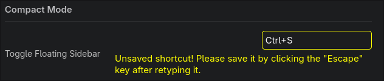

> Zen, I can't `ESC`ape (`zice`)
> `zice` actually matter 




This is just a tool I'm creating to easily bypass the need of using the `ESC`
key for saving the keybinding for zen browser. But why? Well... my `ESC` key
developed it's own personality and refuses to work under the current
geopolitical circumstances (actully, I typed way too hard to mimic the sound
of brown switches, and now is not working). 


**Required `env` variables:**

```bash
export ZEN_CONFIG_PATH="..."
```

